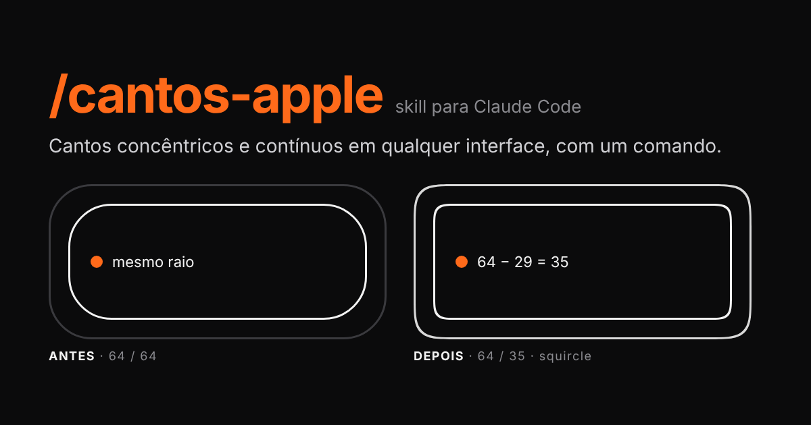

# /cantos-apple

**A Claude Code skill that makes your app's rounded corners follow Apple's style: concentric and continuous. Run `/cantos-apple` and you're done.**

[🇧🇷 Português](README.md) | 🇺🇸 English



Card with a button inside, input with an icon, image inside a card, modal with a list: when both elements use the same `border-radius`, the inner corner looks "fat" and the gap at the corner is wider than on the sides. Nobody can name it, everybody sees it.

The skill finds these pairs in your code, computes the right radius, applies it and shows you a table of what changed.

## Easiest way: give the link to your AI

Open Claude Code (or Cursor, Codex, Copilot) in your project and paste:

```text
Read https://github.com/guilhermeforprojeto/cantos-apple and follow AGENTS.md. Fix the corners in this project. Reply in English.
```

## Install the skill

```bash
npx skills add guilhermeforprojeto/cantos-apple
```

Or clone and run `bash instalar.sh` (macOS/Linux) or `powershell -ExecutionPolicy Bypass -File instalar.ps1` (Windows). Then in Claude Code: `/cantos-apple`.

## The two rules

**1. Concentric:** `inner_radius = max(outer_radius − distance, 0)`, where distance = padding + outer border. Card radius 24, padding 12 → inner button radius **12**, not 24. Near zero, the skill uses a 4 px minimum, like Apple's `concentric(minimum:)`.

**2. Continuous (squircle):** a plain `border-radius` is a quarter circle glued to a straight line, so curvature jumps at once. Apple's curve eases in. The skill turns on each platform's native option:

| Platform | Continuous corner | Automatic concentric |
| --- | --- | --- |
| Web (CSS) | `corner-shape: squircle` (Chrome and Edge 139+; not yet Safari/Firefox) | the formula, with `max(calc(...))` |
| SwiftUI | `RoundedRectangle(cornerRadius:, style: .continuous)` | `ConcentricRectangle` + `containerShape` (iOS 26+) |
| UIKit | `layer.cornerCurve = .continuous` | the formula |
| Flutter 3.32+ | `RoundedSuperellipseBorder` | the formula |
| React Native | `borderCurve: 'continuous'` (iOS) | the formula |
| Compose | no native option | the formula |
| Figma | Corner smoothing 60% | the formula |

Code for each in [`referencia/plataformas.md`](referencia/plataformas.md) (Portuguese comments, code is universal). Interactive before/after in [`demo/index.html`](demo/index.html).

## Credits

The `/cantos-apple` command idea comes from a Reel by [@ofelipemart](https://www.instagram.com/ofelipemart/). This is an open, documented version written from scratch. "Apple" is a trademark of Apple Inc.; this project is not affiliated with Apple.

## License

[CC BY 4.0](LICENSE). If it helped, leave a ⭐.
