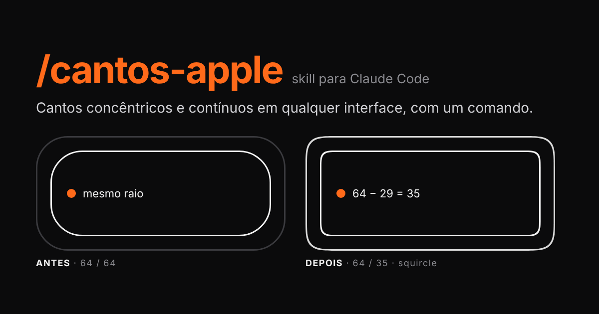

# /cantos-apple

**Uma skill para o Claude Code que deixa os cantos arredondados do seu app no padrão da Apple: concêntricos e contínuos. Você roda `/cantos-apple` e pronto.**

🇧🇷 Português | [🇺🇸 English](README.en.md)



Card com botão dentro, input com ícone, imagem dentro de card, modal com lista: quando os dois elementos usam o mesmo `border-radius`, o canto de dentro fica "gordo" e o espaço no canto fica mais largo que nas laterais. É o tipo de detalhe que ninguém sabe nomear, mas todo mundo vê.

A skill procura esses pares no código, calcula o raio certo, aplica e te mostra uma tabela do que mudou.

---

## Jeito mais fácil: mande o link para a IA

Abra o Claude Code (ou Cursor, Codex, Copilot) na pasta do seu projeto e cole:

```text
Leia https://github.com/guilhermeforprojeto/cantos-apple e siga o AGENTS.md. Corrija os cantos do projeto.
```

## Instalar a skill

Para ter o comando `/cantos-apple` em todos os projetos:

```bash
npx skills add guilhermeforprojeto/cantos-apple
```

Ou clone e rode o instalador:

```bash
git clone https://github.com/guilhermeforprojeto/cantos-apple.git
cd cantos-apple
bash instalar.sh                 # macOS / Linux
# powershell -ExecutionPolicy Bypass -File instalar.ps1   (Windows)
```

Depois, no Claude Code: `/cantos-apple`.

## As duas regras

### 1. Concêntrico

```
raio_de_dentro = max(raio_de_fora − distância, 0)
distância = padding + borda do elemento de fora
```

Card com raio 24 e padding 12 → botão dentro com raio **12**, não 24. Se o resultado ficar perto de zero, a skill usa um mínimo de 4 px, como o `concentric(minimum:)` da Apple.

### 2. Contínuo (squircle)

O `border-radius` comum é um quarto de círculo colado numa reta: a curvatura salta de uma vez. A Apple usa uma curva que começa suave e vai fechando. A skill liga o recurso nativo de cada plataforma:

| Plataforma | Canto contínuo | Concêntrico automático |
| --- | --- | --- |
| Web (CSS) | `corner-shape: squircle` (Chrome e Edge 139+; Safari e Firefox ainda não) | a conta, com `max(calc(...))` |
| SwiftUI | `RoundedRectangle(cornerRadius:, style: .continuous)` | `ConcentricRectangle` + `containerShape` (iOS 26+) |
| UIKit | `layer.cornerCurve = .continuous` | a conta |
| Flutter 3.32+ | `RoundedSuperellipseBorder` | a conta |
| React Native | `borderCurve: 'continuous'` (iOS) | a conta |
| Compose | sem nativo | a conta |
| Figma | Corner smoothing 60% | a conta |

Código de cada uma em [`referencia/plataformas.md`](referencia/plataformas.md).

## Veja funcionando

Abra [`demo/index.html`](demo/index.html) no navegador: dois cards lado a lado e controles de raio e padding. No Chrome ou Edge você vê também o canto contínuo.

## O que tem aqui

| Arquivo | Para quê |
| --- | --- |
| [`skills/cantos-apple/SKILL.md`](skills/cantos-apple/SKILL.md) | A skill: mapear, calcular, aplicar, conferir, relatar |
| [`AGENTS.md`](AGENTS.md) | O que a IA faz quando recebe o link |
| [`referencia/plataformas.md`](referencia/plataformas.md) | Código para web, Tailwind, SwiftUI, UIKit, Flutter, React Native, Compose e Figma |
| [`demo/index.html`](demo/index.html) | Antes e depois interativo |
| [`prompts/`](prompts) | Prompts prontos em português e inglês |
| `instalar.sh` / `instalar.ps1` | Instalam a skill em `~/.claude/skills` |

## Créditos

Ideia do comando `/cantos-apple` vista no Reels de [@ofelipemart](https://www.instagram.com/ofelipemart/) ("Design da Apple pro seu aplicativo"). Esta é uma versão aberta e documentada, escrita do zero. Referências técnicas: [MDN `corner-shape`](https://developer.mozilla.org/en-US/docs/Web/CSS/corner-shape), [Apple `ConcentricRectangle`](https://developer.apple.com/documentation/swiftui/concentricrectangle), [Flutter `RoundedSuperellipseBorder`](https://api.flutter.dev/flutter/painting/RoundedSuperellipseBorder-class.html).

"Apple" é marca da Apple Inc. Este projeto não tem relação com a Apple.

## Licença

[CC BY 4.0](LICENSE): use, adapte e compartilhe, citando a fonte.

Se te ajudou, deixa uma ⭐.
